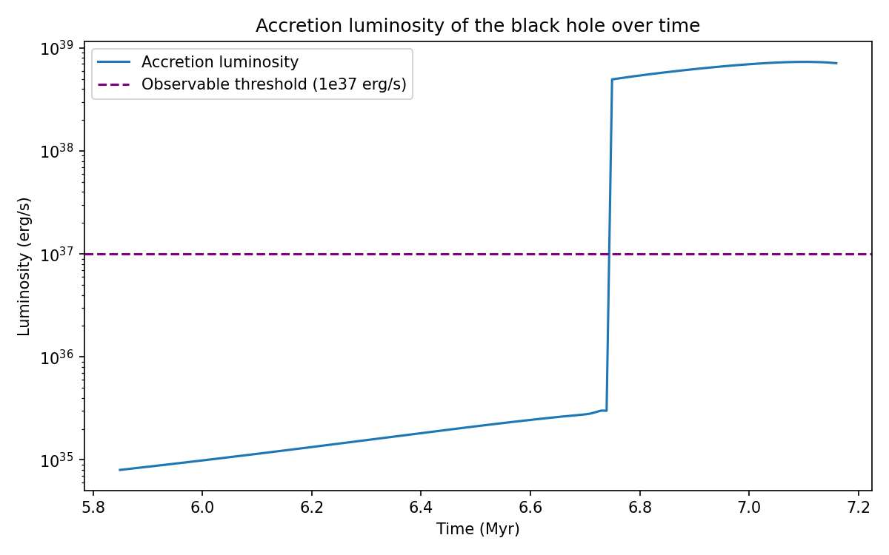

# Accretion luminosity of a black hole in an x-ray binary

A Python model of how bright a black hole looks as it pulls matter from a companion star, using output from the COSMIC binary-evolution code. It converts mass-transfer rates into luminosity and checks whether an x-ray observatory could detect the system.



## What it does

- Computes the black hole's **mass-to-energy efficiency** (`eta`), which grows as the hole gains mass and spins up, capped at 0.42 for a maximally spinning black hole.
- Converts the rate the hole *gains* mass into the rate matter *arrives*, since part of the mass is radiated away: `Mdot_acc = Mdot_BH / (1 - eta)`.
- Applies `L = eta * Mdot_acc * c^2` and an 0.8 bolometric correction to get luminosity in erg/s.
- Compares the result to a 1e37 erg/s detection threshold (a typical Chandra limit).
- Includes a loop version and a vectorized array version, confirms they agree, and times both.

## Results on the sample system

- A test system (M_BH = 11.645 Msun, M_BH0 = 11.611 Msun, Mdot = 3.026e-7 Msun/yr) gives about 8.4e38 erg/s.
- Luminosity stays near 1e35 erg/s, then jumps about four orders of magnitude near 6.75 million years.
- Peak luminosity is about 7.3e38 erg/s, and the system is detectable after the jump.

## Run it

```
pip install -r requirements.txt
python accretion_luminosity.py
```

The script downloads `cosmic_data_1.csv` from the public REACHpy repository on first run.

## Notes

- All constants are in CGS units so luminosity comes out in erg/s.
- Black hole mass at formation (`mass0_2`) and current mass (`mass_2`) are passed in that order: `calc_lacc(m_bh, m_bh0, mdot_bh)`.

## Credit

This is a course exercise from the CIERA REACH program at Northwestern University. The equations, dataset, and problem setup come from the program: https://github.com/CIERA-Northwestern/REACHpy. My work is the implementation, the vectorized version, the unit handling, and the analysis.
